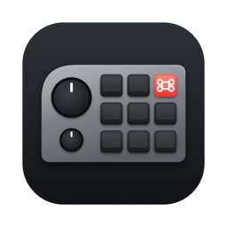
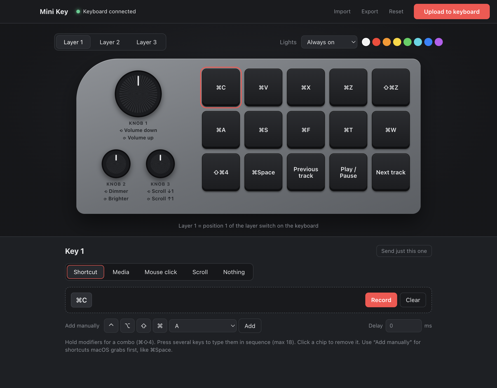

<p align="center">
  
</p>

<h1 align="center">Mini Key</h1>

<p align="center">
  <b>An English, macOS-native configurator for SIKAI CASE programmable mini keyboards</b><br>
  (and the many other rebranded “MINI KeyBoard” macro pads built on the same chip)
</p>



The official configuration software for these keyboards is Windows-only and Chinese-only. Mini Key
lets you program the keys, knobs, layers and lights **from a Mac**. Settings are written to the
keyboard's own memory, so they keep working on any computer (Mac, Windows, Linux, iPad) with no
software running.

- Visual editor that looks like the real device (15 keys + 1 big knob + 2 small knobs)
- Record shortcuts by pressing them (`⌘C`, `⌘⇧4`, …), or build them manually
- Macros: up to 18 keystrokes in sequence, with an optional delay
- Media keys (volume, play/pause, next/previous, brightness, …)
- Mouse clicks and scroll wheel
- 3 layers (selected by the switch on the keyboard)
- LED modes and colors per layer
- Profiles saved automatically, plus import/export as JSON

> ⚠️ This is an unofficial community project. It is not affiliated with SIKAI CASE or the chip vendor.
> It uses a reverse-engineered protocol. It has worked fine in testing, but you use it at your own risk.

---

## Contents

- [Compatible keyboards](#compatible-keyboards)
- [Install & run](#install--run)
- [Using the app](#using-the-app)
- [Troubleshooting](#troubleshooting)
- [Technical details](#technical-details)
  - [USB / HID interface](#usb--hid-interface)
  - [Protocol](#protocol)
  - [Key & knob IDs](#key--knob-ids)
  - [Action encodings](#action-encodings)
  - [LED encoding](#led-encoding)
  - [Profile file format](#profile-file-format)
- [Project structure](#project-structure)
- [Development](#development)
- [Credits](#credits)
- [License](#license)

---

## Compatible keyboards

The keyboards are identified by **USB vendor ID `0x1189`**. What matters is the **product ID**,
which tells you which firmware or protocol the keyboard speaks.

| USB ID | Firmware family | Status in Mini Key |
| --- | --- | --- |
| `1189:8840` | 884x | ✅ **Supported, tested** (SIKAI 15-key + 3-knob pad) |
| `1189:8842` | 884x | ✅ Supported (same protocol, not tested on hardware by the author) |
| `1189:8890` | 8890 (older, 3-key / 1-knob pads) | ❌ Not supported: different protocol. The app detects it and says so. |
| `1189:8850` | 8850 (4×4) | ❌ Not supported |

**Layouts:** the UI currently models the **15 keys + 3 knobs** layout (3×5 keys, one large knob, two
small knobs, 3-position layer switch). Other 884x layouts, such as 12 keys + 2 knobs or 6 keys + 1 knob,
use the same protocol. You can program them by using the first N keys and knobs in the app, but the
picture won't match your device. Pull requests that add other layouts are welcome. The
protocol layer already handles them.

These keyboards are sold under many names: **SIKAI CASE**, "MINI KeyBoard", "Customized Mini
Keyboard", ESERGY FORT, BRIMFORD, and many unbranded AliExpress/Amazon macro pads.

### How to check your keyboard's USB ID (macOS)

Plug it in with a **USB cable** (not Bluetooth or a 2.4 GHz dongle) and run:

```bash
hidutil list | grep -i 0x1189
# or
system_profiler SPUSBDataType | grep -B3 -A6 -i 0x1189
```

You'll see something like `0x1189 0x8840 … USB Composite Device`.

---

## Install & run

Requirements: macOS (Apple Silicon or Intel), [Node.js](https://nodejs.org) 18 or newer.

```bash
git clone <this repo>
cd mini-key
npm install
npm run dev          # run the app in development mode
```

### Build a standalone app

```bash
npm run build:mac
open "dist/mac-arm64/Mini Key.app"     # note the quotes: the name contains a space
```

You can drag `Mini Key.app` into `/Applications`. The app is **not code-signed**, so the first time
you open it, **right-click → Open → Open**.

---

## Using the app

1. **Connect the keyboard with a USB cable.** The dot in the top bar turns green ("Keyboard connected").
2. **Pick a layer** (Layer 1 / 2 / 3). Each layer is a full set of bindings. The keyboard's layer
   switch chooses which one is active.
3. **Click a key or a knob** on the picture. The editor opens underneath.
   - For knobs, choose **⟲ Turn left**, **Press** or **Turn right ⟳** at the top of the editor.
4. **Choose what it does:**
   - **Shortcut**: click the recording box and press the combo. Hold modifiers for combos (`⌘⇧4`).
     Press several keys to type them in sequence (up to 18 steps). Click a chip to remove it.
     Shortcuts that macOS grabs before any app (`⌘Space`, `⌘Tab`) can be added with
     **Add manually**.
   - **Media**: volume, mute, play/pause, next/previous, brightness, calculator, browser back/forward.
   - **Mouse click**: left, right or middle (or a combination).
   - **Scroll**: wheel up (positive) or down (negative).
   - **Nothing**: the key does nothing.
5. Optionally, set **Lights** for the layer: off, always on, light on press, or shock effects, plus a color.
6. Click **Upload to keyboard**. All 3 layers, the knobs and the lights are written in a few seconds.
   **Send just this one** writes only the selected key or knob action, which is handy for quick tests.

> **Mac modifier mapping:** `⌘ Command` = Win/GUI key, `⌥ Option` = Alt, `⌃ Control` = Ctrl,
> `⇧ Shift` = Shift. A keyboard programmed with `⌘C` sends `Win+C` on Windows.

**The keyboard can't report its current settings.** This is a limitation of the firmware, so Mini Key keeps your
profile in `~/Library/Application Support/mini-key/profile.json`. Use **Export** to back it up, or
to move it to another computer.

---

## Troubleshooting

| Problem | Fix |
| --- | --- |
| "Plug in the keyboard with USB" | Use a data USB cable, not charge-only. Bluetooth and 2.4 GHz connections can't be used for programming. Try another port or hub. |
| "This keyboard uses the 1189:8890 protocol…" | Your pad is the older 8890 family, which isn't supported. Try [ch57x-keyboard-tool](https://github.com/kriomant/ch57x-keyboard-tool). |
| Upload succeeds but keys do nothing | Make sure the layer switch is in the position you edited. Bindings are per layer. |
| A key/knob does the action of a *different* key | The physical order may differ on your model. Please open an issue with your USB ID and which key did what. |
| macOS asks for "Input Monitoring" | Allow it in System Settings → Privacy & Security → Input Monitoring, then restart the app. |
| "App can't be opened because it is from an unidentified developer" | Right-click the app → Open → Open. |
| `open dist/mac-arm64/Mini Key.app` fails | Quote the path: `open "dist/mac-arm64/Mini Key.app"`. |

---

## Technical details

Everything below describes the **884x** firmware (`1189:8840` / `1189:8842`). It is ported from
[kriomant/ch57x-keyboard-tool](https://github.com/kriomant/ch57x-keyboard-tool) (`src/keyboard/k884x.rs`)
and confirmed against a real `1189:8840` device.

### USB / HID interface

The keyboard is a USB composite device (12 Mb/s full-speed) with two HID interfaces:

| Interface | Usage page | Purpose |
| --- | --- | --- |
| 0 | `0xFF00` (vendor-defined), usage `0x01` | **Configuration channel**. This is the one Mini Key writes to |
| 1 | `0x01` Generic Desktop (keyboard, mouse) + `0x0C` Consumer | Normal key, mouse and media input |

HID report descriptor of the configuration interface:

```
06 00 FF    Usage Page (Vendor 0xFF00)
09 01       Usage (0x01)
A1 01       Collection (Application)
85 03         Report ID (3)
09 02         Usage (0x02)
15 00 26 FF 00  Logical Min 0, Max 255
75 08 95 40   Report Size 8, Report Count 64
81 06         Input (Data, Var, Rel)
09 02 15 00 26 FF 00 75 08 95 40
91 06         Output (Data, Var, Rel)   ← 64-byte output report
C0          End Collection
```

So each message is an **output report with ID `0x03` followed by 64 data bytes** (65 bytes on the
wire through hidapi). Mini Key uses [`node-hid`](https://github.com/node-hid/node-hid) (hidapi /
IOKit), which means **no kernel-driver detaching, no libusb and no root** are needed on macOS. Messages are
sent with a ~4 ms gap.

### Protocol

All messages below are shown starting with the report ID byte `03`. Unused bytes are zero-padded to
64 bytes.

**Bind an action to a key or knob:**

```
03 FE <id> <layer> <kind> 00 00 00 00 00 <payload…>
```

- `<id>`: key or knob ID (see below)
- `<layer>`: `1`, `2` or `3`
- `<kind>`: `01` keyboard, `02` media, `03` mouse

**Then commit the binding** (three messages, sent after *every* binding):

```
03 AA AA
03 FD FE FF
03 AA AA
```

**Optional delay for a keyboard macro** (sent right after the binding message, before the commit):

```
03 FE <id> <layer> 05 <delay_lo> <delay_hi>     ; delay in ms, little-endian, max 6000
```

### Key & knob IDs

| Control | ID |
| --- | --- |
| Key *n* (0-based, 0–14) | `n + 1` → `0x01`–`0x0F` |
| Knob *k* (0–2), turn left (CCW) | `16 + 3k` |
| Knob *k*, press | `17 + 3k` |
| Knob *k*, turn right (CW) | `18 + 3k` |

So knob 1 = `0x10/0x11/0x12`, knob 2 = `0x13/0x14/0x15`, knob 3 = `0x16/0x17/0x18`.

> On 12-key + 4-knob models, the 4th knob uses IDs `13/14/15` (taking the place of the last key row).

Mini Key assumes keys are numbered left-to-right, top-to-bottom, and that the large knob is knob 1.
If your unit differs, please report it.

### Action encodings

**Keyboard** (kind `01`): a sequence of up to 18 *chords*.

```
03 FE <id> <layer> 01 00 00 00 00 00 <count> [<mods> <keycode>] × count
```

- `<keycode>` is a standard [USB HID keyboard usage](https://usb.org/sites/default/files/hut1_5.pdf)
  (page 0x07). Examples: `A = 0x04`, `1 = 0x1E`, `Enter = 0x28`, `Space = 0x2C`, `F1 = 0x3A`, `→ = 0x4F`.
- `<mods>` bitmask:

  | Bit | Left | Bit | Right |
  | --- | --- | --- | --- |
  | `0x01` | Ctrl `⌃` | `0x10` | Right Ctrl |
  | `0x02` | Shift `⇧` | `0x20` | Right Shift |
  | `0x04` | Alt / Option `⌥` | `0x40` | Right Alt |
  | `0x08` | Win / Command `⌘` | `0x80` | Right Win |

- A single modifier-only chord (e.g. just `⌘`) is sent with `count = 0` so it can combine with
  other keys pressed at the same time.

Example: key 1, layer 1 → `⌘C`:
`03 FE 01 01 01 00 00 00 00 00 01 08 06`

**Media** (kind `02`): a 16-bit [HID consumer usage](https://usb.org/sites/default/files/hut1_5.pdf) (page 0x0C).

```
03 FE <id> <layer> 02 00 00 00 00 00 00 <usage_lo> <usage_hi>
```

| Action | Usage |
| --- | --- |
| Volume up / down | `0xE9` / `0xEA` |
| Mute | `0xE2` |
| Play/Pause | `0xCD` |
| Next / Previous track | `0xB5` / `0xB6` |
| Stop | `0xB7` |
| Brightness up / down | `0x6F` / `0x70` |
| Calculator | `0x192` |
| Browser home / back / forward | `0x223` / `0x224` / `0x225` |

**Mouse** (kind `03`):

```
click : 03 FE <id> <layer> 03 00 00 00 00 00 01 <mods> <buttons>
wheel : 03 FE <id> <layer> 03 00 00 00 00 00 03 <mods> 00 00 00 <delta:int8>
move  : 03 FE <id> <layer> 03 00 00 00 00 00 05 <mods> 00 <dx:int8> <dy:int8>
drag  : 03 FE <id> <layer> 03 00 00 00 00 00 05 <mods> <buttons> <dx> <dy>
```

`<buttons>`: left `0x01`, right `0x02`, middle `0x04`. `<mods>`: Ctrl `0x01`, Shift `0x02`, Alt `0x04`.
(The app exposes click and wheel; move and drag are documented here for completeness.)

### LED encoding

```
03 FE B0 <layer> 08 00 00 00 00 00 01 00 <code>
03 FD FE FF
```

`<code> = (color << 4) | mode`

| Mode | Value | | Color | Value |
| --- | --- | --- | --- | --- |
| Off | `0` | | White (backlight only) | `0`, with mode `5` |
| Backlight, always on | `1` | | Red | `1` |
| Shock | `2` | | Orange | `2` |
| Shock 2 | `3` | | Yellow | `3` |
| Light on press | `4` | | Green | `4` |
| Backlight white | `5` | | Cyan | `5` |
| | | | Blue | `6` |
| | | | Purple | `7` |

Example: backlight cyan on layer 1 → `03 FE B0 01 08 00 00 00 00 00 01 00 51`.

### Reading back

The firmware has no known "read configuration" command, so configurators can only write.

### Profile file format

`profile.json` (also the Import/Export format):

```jsonc
{
  "version": 1,
  "layers": [                       // exactly 3
    {
      "keys": [                     // 15 actions, left→right, top→bottom
        { "type": "keys", "steps": [{ "mods": 8, "code": 6 }], "delay": 0 },  // ⌘C
        { "type": "media", "code": 233 },                                     // volume up
        { "type": "click", "buttons": 1 },                                    // left click
        { "type": "wheel", "delta": -1 },                                     // scroll down
        { "type": "none" }
        // …
      ],
      "knobs": [                    // 3 knobs: big, small left, small right
        { "ccw": { "type": "media", "code": 234 },
          "press": { "type": "media", "code": 226 },
          "cw": { "type": "media", "code": 233 } }
        // …
      ],
      "led": { "mode": "backlight", "color": "white" }
    }
  ]
}
```

---

## Project structure

Built with **Electron + React + TypeScript**, bundled by [electron-vite](https://electron-vite.org).

```
src/
├── shared/                 # pure, platform-independent logic (unit tested)
│   ├── protocol.ts         # 884x wire protocol encoder (bindings, LEDs, full profile)
│   ├── protocol.test.ts    # byte-level tests (vectors from ch57x-keyboard-tool)
│   ├── keycodes.ts         # HID usage tables, browser-key → HID mapping, Mac labels
│   ├── profile.ts          # default profile + validation of loaded/imported JSON
│   ├── profile.test.ts     # validation tests
│   └── types.ts            # Profile / Layer / Action types
├── main/                   # Electron main process
│   ├── index.ts            # window, IPC handlers, profile storage, recorder key capture
│   └── hid.ts              # device discovery + report writing via node-hid
├── preload/index.ts        # safe `window.miniKey` bridge for the UI
└── renderer/               # React UI
    └── src/
        ├── App.tsx         # layout: top bar, layers/lights, pad, editor dock
        ├── Pad.tsx         # the visual keyboard
        ├── Editor.tsx      # action editor + shortcut recorder
        └── styles.css
```

A few implementation notes:

- **Shortcut recording.** While recording, the main process intercepts keys with
  `before-input-event` and forwards them to the UI. That way shortcuts like `⌘W` or `⌘Q` are
  recorded instead of closing the app.
- **Native module.** `node-hid` v3 ships N-API prebuilt binaries, so no `electron-rebuild` is
  needed (`npmRebuild: false` in the electron-builder config).
- **Untrusted profiles.** Imported or loaded JSON goes through `normalizeProfile` / `sanitizeAction`,
  which clamps every value into protocol range, so a bad file can't send garbage to the keyboard.
- **Unsupported devices.** `hid.ts` refuses to write to anything other than `1189:8840/8842` on usage
  page `0xFF00`.

---

## Development

```bash
npm run dev         # hot-reloading dev app
npm test            # protocol + profile unit tests (vitest)
npm run typecheck   # TypeScript check
npm run build       # production bundle into out/
npm run build:mac   # unsigned .app into dist/mac-arm64/
```

`MINIKEY_SNAPSHOT=/path/to/out.png npm start` renders the window to a PNG and quits. It's useful
for updating the screenshot in this README.

### Contributing

Especially welcome:

- **Other layouts** (6+1, 12+2, 12+4, …): add a layout description and draw it in `Pad.tsx`
- **8890 / 8850 support**: port `k8890.rs` / `k8850_4x4.rs` from ch57x-keyboard-tool
- **Windows/Linux builds**: the code is cross-platform. Only packaging and udev rules are missing
- Reports of key-order differences on your model (please include the USB ID)

---

## Credits

- Protocol reverse engineering: [**kriomant/ch57x-keyboard-tool**](https://github.com/kriomant/ch57x-keyboard-tool)
  (MIT) and its contributors, plus [kamaaina/macropad_tool](https://github.com/kamaaina/macropad_tool)
  for LED captures.
- USB access: [node-hid](https://github.com/node-hid/node-hid) (MIT / X11).

## License

[MIT](LICENSE)
